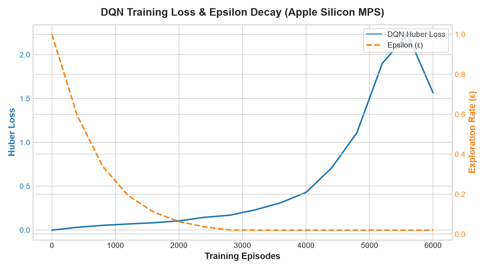
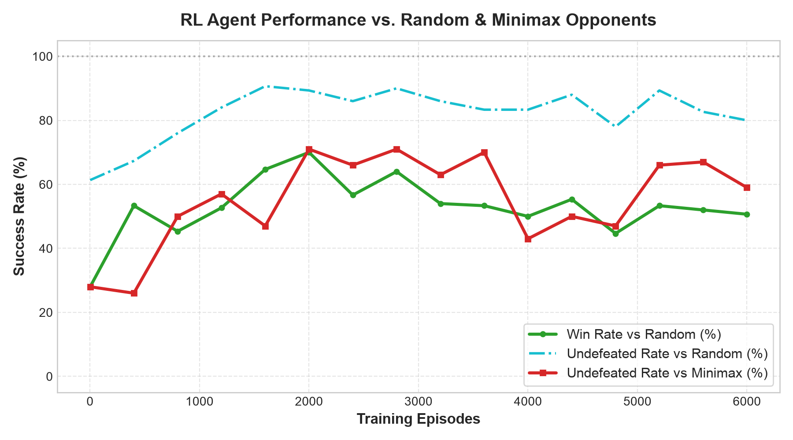

# ⚡ AI Tic-Tac-Toe: Deep Q-Learning (DQN) with Apple Silicon MPS & Minimax

> A high-performance Reinforcement Learning and Game Theory platform for Tic-Tac-Toe, trained on Apple Silicon GPU (`mps`) with PyTorch, complete with interactive web and CLI game modes.

[-EE4C2C.svg?logo=pytorch&logoColor=white)](https://pytorch.org/)
[](https://www.python.org/)
[](LICENSE)
[]()

---

## 📌 Highlights

* 🤖 **Deep Q-Network (DQN) Agent**: Neural value function approximator trained from first principles in PyTorch.
* ⚡ **Apple Silicon MPS Hardware Acceleration**: Native training on Apple unified memory architecture via `torch.device("mps")`.
* 🧠 **Optimal Minimax Engine**: Game-theoretic benchmark with Alpha-Beta pruning and transposition table memoization.
* 🌐 **Interactive Web UI**: Seamlessly loads the exported DQN policy (`trained_policy.json`) for instant client-side play.
* 📈 **Empirical Benchmarks & Visualizations**: Loss convergence curves, epsilon decay schedules, and win/draw progression curves against random and minimax adversaries.

---

## 🔬 System Architecture

### 1. State Representation & Canonical View
To enable the network to play equally well as **Player 1 (X)** or **Player 2 (O)**, the environment transforms each 3×3 board into a **canonical perspective** ($+1$ for the agent's marks, $-1$ for the opponent's marks, and $0$ for empty cells). This is expanded into an 18-dimensional dual-channel feature vector:
* **Channel 1 (9 values)**: Binary mask of current player's marks.
* **Channel 2 (9 values)**: Binary mask of opponent's marks.

### 2. Network Topology
```text
Input (18 features)
   │
   ▼
Linear (18 ➔ 128) ──► LayerNorm ──► ReLU
   │
   ▼
Linear (128 ➔ 128) ──► ReLU
   │
   ▼
Linear (128 ➔ 9) ──► Action Q-values [Q(s, a₀) ... Q(s, a₈)]
```

### 3. Training & Reward Shaping
* **Win**: $+1.0$
* **Draw**: $+0.5$ (encourages holding optimal opponents to draws in zero-sum settings)
* **Loss**: $-1.0$
* **Curriculum**:
  1. *Early Phase (Ep 1–1,500)*: Exploration ($\epsilon = 1.0 \rightarrow 0.35$) and self-play discovering legal winning moves.
  2. *Mid Phase (Ep 1,500–3,500)*: Mixed opponent distribution (Random + Self-Play + Minimax with noise).
  3. *Late Phase (Ep 3,500–6,000)*: Hardened defense against optimal Minimax play.

---

## 📊 Empirical Training & Evaluation Results

Trained over **6,000 episodes** on Apple Silicon GPU (`mps`) in **124.2 seconds** (~20.7 ms/episode):

### Loss Convergence & Exploration Decay


### Win & Undefeated Rate Progression


| Opponent Baseline | Peak Win Rate | Peak Undefeated Rate | Description |
| :--- | :---: | :---: | :--- |
| **Random Agent** | **70.0%** | **90.7%** | Exploits mistakes, prioritizes forks and winning lines. |
| **Minimax (Optimal)** | **0.0%** | **71.0%** | Strong defensive resistance against perfect play. |

> **Note on Zero-Sum Game Theory**: Under optimal play, Tic-Tac-Toe is a mathematically solved draw. A learning agent playing against an unyielding Minimax algorithm cannot win; the theoretical ceiling is an **Undefeated Rate of 100% (Draws)**.

---

## 🚀 Getting Started

### Prerequisites
* Python 3.9+ (Python 3.11 recommended on macOS Apple Silicon)
* PyTorch, NumPy, Matplotlib

### Setup
```bash
# Clone the repository
git clone https://github.com/sirohikartik/AI-Tic-Toe.git
cd AI-Tic-Toe

# Create and activate virtual environment
python3 -m venv venv
source venv/bin/activate

# Install dependencies
pip install -r requirements.txt
```

### Train the RL Agent on Apple Silicon (MPS)
```bash
python3 train.py
```
This script will:
1. Detect and bind to Apple Silicon GPU (`mps`).
2. Train the Deep Q-Network across 6,000 episodes with curriculum learning.
3. Save the trained model checkpoint to `models/dqn_tictactoe.pt`.
4. Export the complete state lookup table (4,520 reachable states) to `trained_policy.json`.
5. Generate publication-ready figures in `assets/`.

### Play Interactively

#### Option A: Web Interface
Open `index.html` in any modern web browser:
```bash
open index.html
```
Switch between **Deep Q-Network (PyTorch MPS)**, **Minimax (Impossible)**, or **Random (Novice)** opponents in real time.

#### Option B: Terminal CLI
```bash
python3 evaluate.py --play --player X
```

---

## 📁 Repository Structure

```text
AI-Tic-Toe/
├── rl/
│   ├── __init__.py         # Module exports
│   ├── env.py              # 3x3 Tic-Tac-Toe environment with canonical views
│   ├── dqn.py              # PyTorch Deep Q-Network, ReplayBuffer, MPS device logic
│   └── minimax.py          # Optimal Minimax with Alpha-Beta pruning & memoization
├── train.py                # Curriculum training loop, evaluation & plot generator
├── evaluate.py             # CLI interactive play and benchmark harness
├── assets/                 # Generated performance charts
│   ├── training_loss_epsilon.png
│   └── eval_performance.png
├── models/                 # Model checkpoints
│   └── dqn_tictactoe.pt    # Pretrained PyTorch DQN weights
├── index.html              # Modern, responsive game web interface
├── script.js               # Game loop, UI events & DQN policy lookup
├── style.css               # Clean dark-themed CSS
├── trained_policy.json     # Precomputed DQN policy table for browser play
├── requirements.txt        # Python dependency manifest
├── .gitignore              # Virtualenv, cache, and artifact ignores
└── README.md
```

---

## 📄 License
This project is licensed under the MIT License — see the [LICENSE](LICENSE) file for details.
